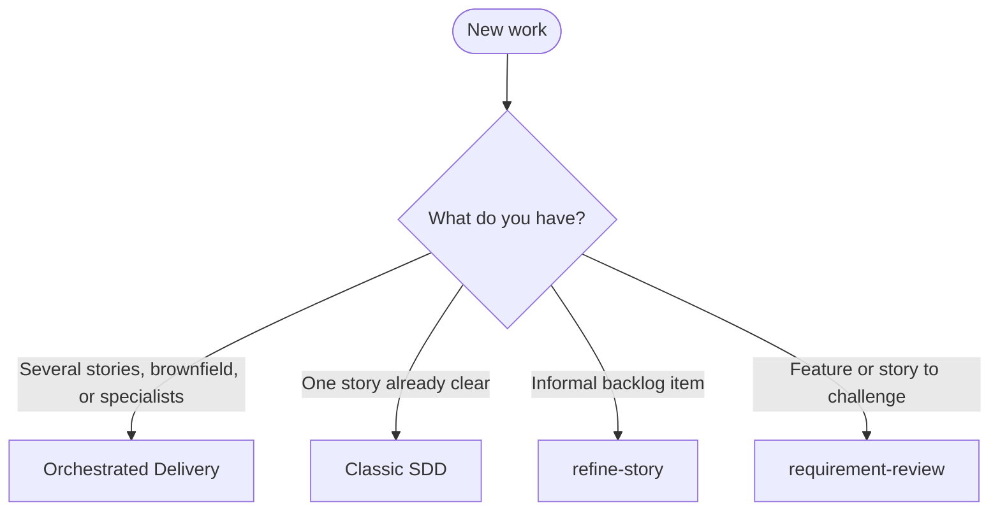

# Agent Dev Toolkit

Unified multi-agent skills core with per-agent adapters. It syncs the same SDD workflows, stack skills, and policy into ten coding agents, listed below.

**Public:** clone and fork freely; **no upstream contributions**; GitHub Issues are **bugs only**. See [CONTRIBUTING.md](CONTRIBUTING.md) and [SECURITY.md](SECURITY.md).

## Install

Prerequisites and full steps: [docs/INSTALL.md](docs/INSTALL.md).

**Windows:**

```bat
curl.exe -fsSL -o bootstrap.bat https://github.com/tibursocampos/agent-dev-toolkit/releases/latest/download/bootstrap.bat
bootstrap.bat
```

**Linux and macOS** (needs [pwsh 7+](https://learn.microsoft.com/powershell/scripting/install/installing-powershell)):

```bash
curl -fsSL -o bootstrap.ps1 https://github.com/tibursocampos/agent-dev-toolkit/releases/latest/download/bootstrap.ps1
pwsh -NoProfile -File ./bootstrap.ps1
```

**Or clone the repository:**

```powershell
git clone https://github.com/tibursocampos/agent-dev-toolkit.git agent-dev-toolkit
cd agent-dev-toolkit
pwsh -NoProfile -File .\scripts\toolkit.ps1
```

## Which flow?



Decision guide and entry points: [Choosing the flow](docs/guides/flow-selection.md).

## Supported agents

- Cursor (`cursor`)
- Antigravity (`antigravity`)
- Claude Code (`claude`)
- Codex (`codex`)
- GitHub Copilot (`copilot`)
- OpenCode (`opencode`)
- Grok Build (`grok`)
- ZCode (`zcode`)
- Hermes (`hermes`)
- OpenHands (`openhands`)

Live roots, publish layouts, and notes per agent: [docs/ADAPTERS.md](docs/ADAPTERS.md).

## Documentation

| Document | Content |
|----------|---------|
| [docs/README.md](docs/README.md) | Documentation index |
| [docs/SKILLS.md](docs/SKILLS.md) | Skill catalog |
| [docs/INSTALL.md](docs/INSTALL.md) | Install, sync, uninstall |
| [docs/VALIDATION.md](docs/VALIDATION.md) | Validation and CI |
| [docs/guides/README.md](docs/guides/README.md) | Guides and decision tree |

## Safety

- Default `InstallRoot` is an **in-repo fixture** — CI never writes under `%USERPROFILE%`.
- Live agent home requires **`-AllowUserHome`**.
- Uninstall is **keyed** (toolkit artifacts only) for all adapters — **not** a wholesale home wipe. Preserves `sdd/sessions` and `sdd/manifest.json`.

## License

[MIT](LICENSE) © 2026 Raphael Campos. See [CONTRIBUTING.md](CONTRIBUTING.md) for contribution policy.
