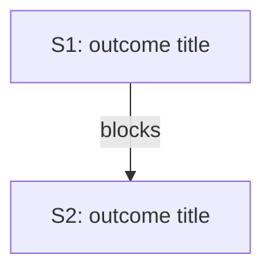

# PLAN: [Nome da feature]

| Campo | Valor |
|-------|--------|
| **PRD** | [caminho portátil do PRD — `STORAGE.md` § Portable path] |
| **Repositório** | [nome do PRD / raiz git] |
| **Stack** | [.NET / Angular / outro] |
| **Complexidade** | Baixa / Média / Alta |
| **Total de passos** | N |
| **Progresso** | 0/N |
| **Track** | Classic SDD / … |
| **Status** | draft \| approved |
| **Implementation status** | `NOT_STARTED` |

## Execution policy

| Field | Value |
|-------|--------|
| **Orchestrator mode** | `always` / `adaptive` (from `{{SDD_ROOT}}/preferences.json`; default `adaptive`) |
| **Bounded authorization** | `none` unless the operator explicitly authorizes a finite scope; when present, record source, actions, step IDs/range, and limits |
| **Parent role** | Orchestrator only — delegate implementation to specialists |
| **Child validation** | After file changes: child runs build + tests; reports `{ build, tests, summary }` |
| **Handoff** | Scoped paths + receipt per `SPAWN.md` — no full PLAN/PRD dump into child prompts |

```
[⚪⚪⚪⚪⚪⚪⚪⚪] 0% (0/N)
```

## Related

| Relação | Path portátil |
|---------|---------------|
| PRD | `features/NNN-slug/USnn/PRD/NNN_….md` |
| STORY | `features/NNN-slug/USnn/STORY.md` (omit if absent) |
| FEATURE | `features/NNN-slug/FEATURE.md` (omit if absent) |
| CONTINUITY | `features/NNN-slug/CONTINUITY.md` (omit if absent) |
| ANALYSIS index | `features/NNN-slug/USnn/ANALYSIS/…` (omit if absent) |
| ARCH | `features/NNN-slug/USnn/ARCH/…` (omit if absent) |

Title **must** be `## Related` (`STORAGE.md` § Navigation block; RN05). Keep in sync with header **PRD** path. Omit-if-absent — do not stub siblings only for links.

## Objectives

- [ ] O1: [Resultado mensurável ligado a REQ/CA do PRD]
- [ ] O2: [Resultado mensurável]
- [ ] O3: [Opcional]

## Target tree

```
[caminhos principais — só paths, sem código]
```

## Validation strategy

- [ ] [Como verificar — unitário, integração, script, checklist]
- [ ] Retrieval seletivo: skills tocadas não prescritem dump integral de `memory-bank/` nem do PRD (CT5 / `SELECTIVE-RETRIEVAL.md`)
- [ ] Build passa local / CI

## Mapa REQ → passo

| REQ | Passo |
|-----|-------|
| REQ-001 | {{STEP_ID}} |

Every PRD REQ appears. A step's acceptance cites the REQ. Prose in this file follows the chat language (`LANGUAGE.md`). Status tokens stay the English tokens in `status-legend.md`.

## Acceptance traceability

| REQ | CA | Step | Validation (test/check) | Where (portable PRD path + section) | Evidence / result |
|-----|----|------|-------------------------|------------------------------------|-------------------|
| REQ-001 | CA1 | S1 | CT1 / named check | `features/.../PRD/NNN_….md` §2, §4, §10 | `PLANNED` |

Include every PRD REQ and CA; a criterion may use multiple rows when its checks
belong to different steps. The validation names the observable test, script, or
manual check. Before implementation starts, the PLAN must show each REQ→CA→step
mapping, its planned validation, explicit dependencies, and scope/OOS source. Missing
mapping, validation, or dependency information is a DoR gap and blocks the first
implementation step. Do not invent behavior to fill a gap.

The evidence cell is `PLANNED` before execution, then records a portable evidence
path or concise result after validation. Use `BLOCKED` when a required result is
missing or failed; a blocked required row prevents its step/PLAN completion. `READY`
is not an evidence state and does not satisfy this implementation DoR.

## Readiness and completion contract

- **Implementation DoR (before the first step):** canonical approved PRD and PLAN;
  complete REQ→CA→step traceability; observable acceptance and planned checks for
  each step; explicit scope/OOS and dependencies; no unresolved decision that can
  change scope, implementation, or acceptance. Record the review result and any
  portable supporting paths. Missing evidence means DoR is unsatisfied.
- **Step DoD:** mark a step `COMPLETED` only when its acceptance is met, all checks
  declared for that step pass, and evidence/results are recorded in the step ledger.
- **US/PLAN DoD:** reconcile every required REQ and CA with implementation and test
  evidence, resolve required failures and blocking findings, and record applicable
  final checks before closing the scope.
- **Develop-session gate lifecycle:** finish all implementation and artifact edits,
  re-read the final artifacts, and complete required validations before recording
  `tests_run`. Update step status/evidence while the confirmed gate is still active,
  then reset the session as the final operation. A successful `reset` clears both
  gates and ends that develop scope: do not run another helper, validator, or edit
  artifacts afterward. A needed post-reset correction starts a fresh, explicitly
  authorized develop scope/session; never rerun `tests-run` against cleared gates.
- **Clarification `READY`:** retain the independent meaning in
  `readiness-severity.md` (no unanswered B/I/MINOR questions). It neither proves
  implementation DoR nor authorizes a step or proves DoD.

Do not mark a required evidence row `PASS` based only on a plan to run a check.

## Current implementation evidence

Record only evidence actually read, using portable paths and the relevant section or symbol. For each material behavior, state what the evidence demonstrates and its limit; distinguish current behavior from a proposal, inference, or gap. Apply `skills/_shared/sdd-artifacts/SEMANTIC-SUFFICIENCY.md` rather than copying its full criteria here. Trace source/producer, selection/route, receiver, and effect only when relevant. A receiver does not prove a publisher or integration; do not imply a messaging role where none applies. Record an unproven link as “not demonstrated,” not as absent unless the searched evidence supports that conclusion. Static evidence does not prove live activation or runtime.

| REQ/CA or behavior | Source path searched + section/symbol read | Source role | What it demonstrates or gap | Limit |
|--------------------|------------------------------------------|-------------|-----------------------------|-------|
| {{REQ_CA_BEHAVIOR}} | {{PORTABLE_PATH_AND_ANCHOR}} | {{SOURCE_ROLE}} | {{DEMONSTRATED_BEHAVIOR_OR_GAP}} | {{PROOF_LIMIT}} |

## Impact map

| Area | Current behavior and read evidence | Planned impact / disposition |
|------|--------------------------------------|-----------------------------|
| {{AREA}} | {{READ_BEHAVIOR_AND_PORTABLE_EVIDENCE}} | {{PLANNED_IMPACT_AND_DISPOSITION}} |

An area that does not change still needs a repository-backed reason. Mark proposed changes as proposals; do not report them as current behavior.

## Artifacts and symbols

| Path | Action | Label |
|------|--------|-------|
| {{PATH}} | `CREATE` \| `MODIFY` \| `REMOVE` \| `NO_CHANGE` | existing path was read, or `proposed` |

An existing path must have been read. A new path is labeled `proposed`. A validation command appears only when the repo already shows that command. Do not claim the command already ran.

## Dependency and execution graph

One Mermaid `flowchart`. This graph is step order only. It is not a class or file diagram. In `orchestrated`, use every validated step id from `REFINE/tasks.md` once. In `direct`, use PLAN-native step ids unless an explicitly linked valid checklist was adopted; do not require or invent `REFINE/tasks.md` rows. Every blocking dependency demonstrated by the plan is an arrow labeled `blocks`; a step with dependency `none` has no incoming arrow. A diagram that only lists nodes and has no arrows is invalid when any step depends on another.



## Implementation progress

Persisted ledger. `sdd-develop` updates status and evidence after each step. `Analysis weight` is qualitative (`Low`, `Medium`, `High`, `Very high`). It is not duration, effort, or story points.

| Step ID | Step | Dependencies | Analysis weight | Status | Evidence |
|---------|------|--------------|-----------------|--------|----------|
| S1 | outcome title | none | Medium | `PENDING` | — |

## Passos de implementação

One block per step. In `orchestrated`, copy the id, title, and dependencies from the validated `REFINE/tasks.md` owned by `split-story-checklist`. In `direct`, derive PLAN-native ids, titles, and dependencies from the approved PRD unless an explicitly linked valid checklist was adopted. A direct PLAN may be complex and have no task file; do not invent task rows or ids. O2 checklist requirements remain in force for `orchestrated`.

Separate each step: a blank line, then the heading, then one field per line, then a `---` rule before the next step. Status glyphs match `LIVE-STAGE-TABLE.md`: `☐` pending, `◐` in progress, `☑` completed, `⊘` closed without success, `⚠` blocked. The status token stays English.

No duration. Do not paste a new method body. A contract signature and a short excerpt of code that already exists (path and line) are anchors, not the implementation.

### STEP 1 — S1: outcome title

☐ `PENDING`

- **Depends on:** none
- **Wave:** 1
- **Parallel-safe:** no
- **Goal:** observable outcome
- **Symbols:** existing type read in the repo, or `ProposedName` (`proposed`)
- **Artifacts:** `CREATE` or `MODIFY` path (`proposed` or existing)
- **Change:** what this step changes, and what it must not touch
- **Signature:** route, method, or DI registration when that is the boundary. Omit the new method body
- **Anchor:** `path/File.cs:line` plus a short excerpt of current code, or `none`
- **Tests:** positive, negative, and boundary when the criterion requires them
- **Acceptance:** the REQ and CA text, not only the id. Where: `features/.../PRD/....md` §2 and §4
- **Task boxes (orchestrated or adopted checklist only):** `S1` rows in `features/.../REFINE/tasks.md`; otherwise `not applicable (direct PLAN-native step)`
- **Validation command:** command already present in the repo, or omit
- **Step risk:** evidence path

---

### STEP 2 — S2: next outcome

☐ `PENDING`

- **Depends on:** S1
- **Wave:** 2
- **Parallel-safe:** no
- **Goal:** observable outcome
- **Symbols:** existing type, or `ProposedName` (`proposed`)
- **Artifacts:** `MODIFY` path (existing)
- **Change:** what this step changes, and what it must not touch
- **Signature:** omit when this step has no new contract boundary
- **Anchor:** `path/File.cs:line`, or `none`
- **Tests:** the case that proves this step
- **Acceptance:** REQ and CA text. Where: PRD path and section
- **Task boxes (orchestrated or adopted checklist only):** `S2` rows in `REFINE/tasks.md`; otherwise `not applicable (direct PLAN-native step)`
- **Validation command:** omit or the repo command
- **Step risk:** evidence path

---

## Test strategy

BDD describes observable behavior and acceptance; it does not require one
automated test per scenario or a new test in every PLAN step. TDD is a selective
implementation technique: use test-first feedback when it gives timely,
distinct evidence for the changed behavior, risk, or boundary. Choose checks
from behavior and existing coverage, not from a blanket test-per-step rule.

Before implementation, record one decision per behavior (or group behaviors
only when they share the same existing evidence and proof boundary). The matrix
records what coverage already exists, the primary proof boundary, disposition,
owner, and when a check will be created or run. Link any additional proof to a
distinct behavior or explain the composition value it adds.

| REQ/CA and observable behavior | Existing coverage/evidence (or none) | Primary proof boundary | Disposition | Additional proof and distinct behavior/composition value | Owner | Create/execute checkpoint | Required/conditional |
|-------------------------------|------------------------------------|------------------------|-------------|-----------------------------------------------------------|-------|---------------------------|----------------------|
| {{REQ_CA_BEHAVIOR}} | {{COVERAGE_OR_NONE}} | {{PRIMARY_BOUNDARY}} | reuse existing \| add/change check \| defer with reason, limit/dependency \| no new check (not applicable, with reason) | {{NONE_OR_DISTINCT_VALUE}} | {{ROLE}} | {{STEP_OR_CHECKPOINT}} | required \| conditional |

Use the disposition that matches the evidence: reuse when current coverage
proves the behavior; add/change a check when a distinct proof is missing; defer
only with a reason, owner, checkpoint, limit, and dependency; or record why another automated check is
not applicable. A deferred check remains pending and cannot satisfy or approve
an intermediate step. It may be assigned to the final test-consolidation step
only when it does not gate that step's acceptance. The final step reviews tests
created or changed across the US, maps each applicable acceptance criterion to tests and recorded evidence, and runs required consolidation checks before the US/PLAN DoD can close.

The `Required` column identifies checks that gate that step. For a
service-to-handler-to-consumer chain, choose one primary boundary for a repeated
validation. Cover a lower layer when it has its own behavior, such as
transformation, error mapping, or validation; test composition when the combined
path adds distinct integration evidence. Follow the consumer's established
runner, libraries, doubles/mocks, and test structure. Do not add a production
interface in test code, a runner, a library, or broad restyling without a
justified in-scope consumer.

Consolidation may remove a test only when its behavior is covered elsewhere and
it provides no unique acceptance, path, boundary, or failure-mode coverage.
Prefer integration or end-to-end coverage for primary user flows while keeping
unit tests that provide distinct feedback. Preserve unrelated smoke tests.

At final consolidation, update `STATE.md` and `EVD/` and run the evidence
validator at the level configured in `STATE.md` (or the repository default).
Keep valid prior evidence. Supersede it only when a newer equivalent or
stronger result covers the same criterion against the current implementation;
record the reason and replacement, and retain the prior evidence artifact.

| Layer | Precondition | Action | Assertion | Required |
|-------|--------------|--------|-----------|----------|
| unit \| integration \| contract \| end-to-end \| manual | {{PRE}} | {{ACTION}} | {{ASSERTION}} | required \| conditional |

## Risks

| Risk | Impact | Evidence | Mitigation |
|------|--------|----------|------------|
| {{RISK}} | {{IMPACT}} | {{PORTABLE_PATH}} | {{MITIGATION}} |

## Open decisions

When none remain, write exactly one sentence in the content-language: `No open decision.` Translate that sentence on Write (`Nenhuma decisão em aberto.` when the chat language is Portuguese). That sentence is not an open decision. Do not leave this heading with an empty body.

## Execution checkpoint

| Field | Value |
|-------|--------|
| last mode | `NOT_STARTED` |
| active step | |
| next eligible | |
| portability | `NOT_STARTED` |

Portability tokens: `NOT_STARTED`, `LOCAL_ONLY`, `SHARED`. No tracker tag.

## Execution order

**Caminho crítico:** 1 -> 2 -> … -> N

**Próximo passo:** PASSO 1 - [título]

## Technical decisions

| Tópico | Decisão | Justificativa |
|--------|---------|---------------|
| [tópico] | [escolha] | [por quê] |

## Delivery risks

| Risco | Impacto | Mitigação |
|-------|---------|-----------|
| [Risco] | Baixo/Médio/Alto | [Ação] |

## References

- PRD: [caminho portátil]
- Retrieval: `skills/_shared/sdd-artifacts/SELECTIVE-RETRIEVAL.md`

## Final checklist

- [ ] Todos os REQ do PRD mapeados em passos
- [ ] Cada passo cabe em uma sessão `sdd-develop`
- [ ] Dependências explícitas; sem ciclos
- [ ] Aceite por passo cita CA/REQ verificáveis
- [ ] Sem código de implementação embutido no PLAN
- [ ] Handoff: `/sdd-develop - <caminho-portátil-do-plan> - Step 1`
