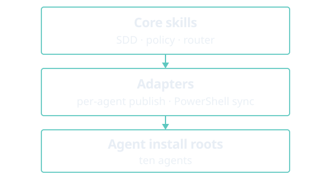

# agent-dev-toolkit

**agent-dev-toolkit** is a developer toolkit for coding agents. One shared core (skills, policy, router, and delivery contracts) is published by adapters into the agent you already use. You sync with a PowerShell CLI, then invoke the same skill ids in that agent.

<figure class="home-diagram">
  
</figure>

**Ten agents:** Cursor, Antigravity, Claude Code, Codex, GitHub Copilot, OpenCode, Grok Build, ZCode, Hermes, and OpenHands.

To try it from a clone, run the interactive menu: `pwsh -NoProfile -File ./scripts/toolkit.ps1`. Downloads and the other install options are on [Get started](get-started.md).

| I want to | Go to |
|-----------|-------|
| Install the toolkit | [Get started](get-started.md) |
| Sync or validate from the command line | [CLI](cli.md) |
| Run my first skill | [First use](first-use.md) |
| Pick the right workflow for a feature | [Orchestrated Delivery](orchestrated-delivery.md) |

Also: [Using skills](using-skills.md), [Adapters](adapters.md), and [Architecture](architecture.md).
