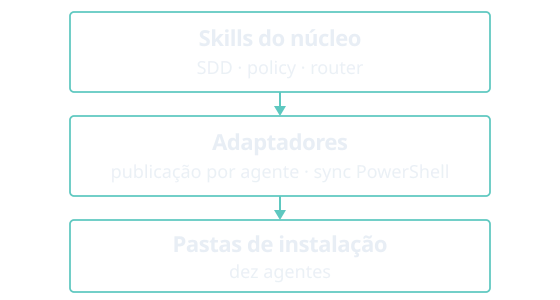

# agent-dev-toolkit

O **agent-dev-toolkit** é um toolkit para agentes de código. Um core compartilhado (skills, política, roteador e contratos de entrega) é publicado por adaptadores no agente que você já usa. O sync é um CLI em PowerShell. Depois disso, os mesmos ids de skill valem nesse agente.

| Quero | Ir para |
|-------|---------|
| Instalar o toolkit | [Começar](get-started.md) |
| Sincronizar ou validar pela linha de comando | [CLI](cli.md) |
| Rodar minha primeira skill | [Primeiro uso](first-use.md) |
| Escolher o fluxo certo para uma feature | [Entrega orquestrada](orchestrated-delivery.md) |

Também: [Usando skills](using-skills.md), [Adaptadores](adapters.md) e [Arquitetura](architecture.md).

<figure class="home-diagram">
  
</figure>

**Dez agentes:** Cursor, Antigravity, Claude Code, Codex, GitHub Copilot, OpenCode, Grok Build, ZCode, Hermes e OpenHands.

Para testar a partir de um clone, rode o menu interativo: `pwsh -NoProfile -File ./scripts/toolkit.ps1`. Os downloads e as outras opções de instalação estão em [Começar](get-started.md).

