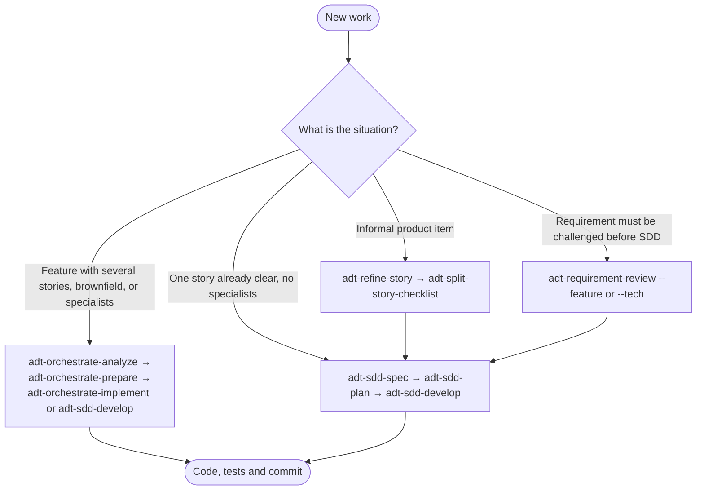

# Choosing the flow

This guide helps you choose which toolkit flow to use before you start: Orchestrated Delivery, Classic SDD, backlog refinement, or requirement review. The choice sets the entry skill and the artifacts that will be written. The details of each flow are in the guides linked from the table.

## Decision tree

The flows are not prerequisites for one another. Classic SDD can start directly, without `adt-orchestrate-analyze`. Suggest the orchestrated path only when there are several stories, brownfield complexity, or specialist folders.

## Flow table

| Flow | When to use | Entry point | Guide or doc |
|------|-------------|-------------|--------------|
| Orchestrated Delivery | Feature with several stories, brownfield, or that needs specialists | `/adt-orchestrate-analyze` | [../sessions/01-orchestrated-delivery.md](../sessions/01-orchestrated-delivery.md) |
| Classic SDD | One story already clear, no need for specialists | `/adt-sdd-spec` | [../sessions/02-classic-sdd.md](../sessions/02-classic-sdd.md) |
| Refine backlog item | Informal product item (bug, user story, or technical story) before SDD | `/adt-refine-story` | [backlog-refine.md](backlog-refine.md) and [../sessions/03-backlog-shape.md](../sessions/03-backlog-shape.md) |
| Review requirement | Check acceptance criteria or contracts before SDD | `/adt-requirement-review --feature` or `--tech` | [../sessions/03-backlog-shape.md](../sessions/03-backlog-shape.md) |

For a trivial single file, use `/adt-developer` or the stack skill, if the operator chooses that shortcut.

## Questions and approval

For Classic SDD and Orchestrated Delivery, only an unanswered decision that affects behavior, acceptance, scope, required access, or implementation blocks the dependent work. Minor questions remain visible; unrelated work may continue. Drafting and saving PRD/PLAN artifacts is preparation. Approve the complete PLAN once before implementation. Backlog refinement and other standalone skills retain their own contracts.

## Write limits

- Canonical PRD and PLAN paths live under `features/NNN-slug/`. Do not create artifacts outside the `features/` tree.
- Without a `features/NNN-slug/` folder, `adt-sdd-spec` does not read `docs/backlog/` on its own. A `.md` from `docs/backlog/` is used only when the operator cites its path (promote in `direct` mode, see [PIPELINE.md](../../core/skills/_shared/sdd-artifacts/PIPELINE.md)) or when the content is pasted into the chat.
- `docs/backlog/` is a write shortcut for `adt-refine-story`, `adt-requirement-review`, and `adt-split-story-checklist`. It is not a canonical source for PRD or PLAN.

## Implementation cadence

Classic `adt-sdd-develop` and O3 use the cadence selected for the approved PLAN: `step_by_step` stops after one completed step; `continuous` advances through eligible steps until completion or a real blocker. O3 dispatches serially, one child per step. The PLAN is the implementation progress source. See [PIPELINE.md](../../core/skills/_shared/sdd-artifacts/PIPELINE.md) for exceptions and consumer ownership.
