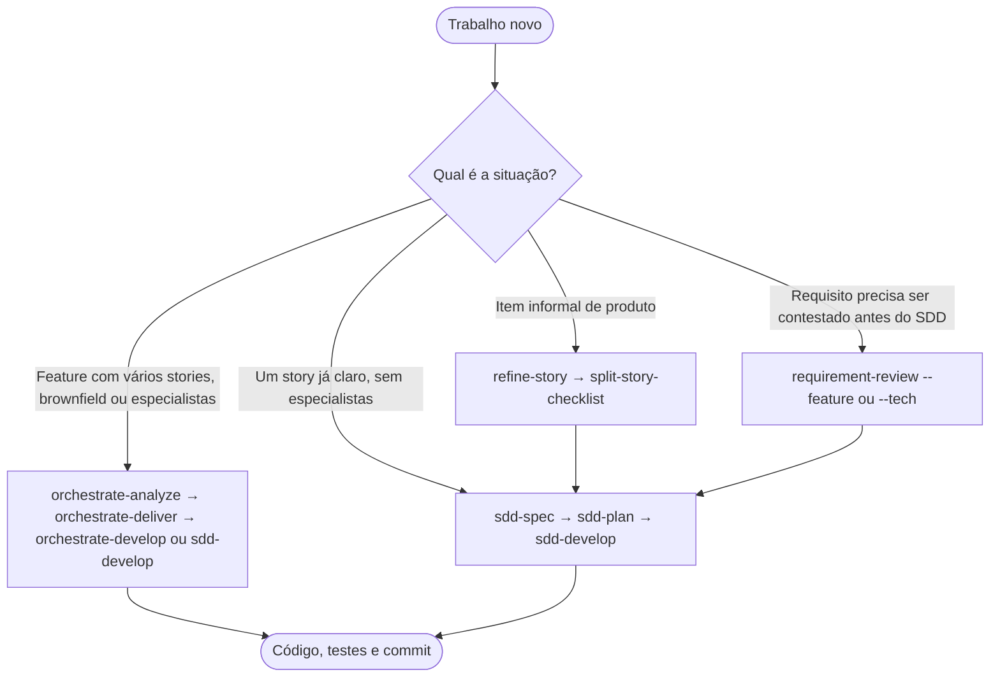

# Escolher o fluxo

Este guia ajuda a escolher, antes de começar, qual fluxo do toolkit usar: Orchestrated Delivery, SDD clássico, refinamento de backlog ou revisão de requisito. A escolha define a skill de entrada e os artefatos que serão gravados. Os detalhes de cada fluxo estão nos guias linkados na tabela.

## Árvore de decisão

Os fluxos não são pré-requisitos uns dos outros. Classic SDD pode começar direto, sem `orchestrate-analyze`. Sugira o orquestrado só quando houver vários stories, complexidade brownfield ou pastas de especialistas.

## Tabela de fluxos

| Fluxo | Quando usar | Ponto de entrada | Guia ou doc |
|-------|-------------|------------------|-------------|
| Orchestrated Delivery | Feature com vários stories, brownfield ou que precise de especialistas | `/orchestrate-analyze` | [../sessions/01-orchestrated-delivery.md](../sessions/01-orchestrated-delivery.md) |
| SDD clássico | Um story já claro, sem necessidade de especialistas | `/sdd-spec` | [../sessions/02-classic-sdd.md](../sessions/02-classic-sdd.md) |
| Refinar item de backlog | Item informal de produto (bug, user story ou história técnica) antes do SDD | `/refine-story` | [backlog-refine.md](backlog-refine.md) e [../sessions/03-backlog-shape.md](../sessions/03-backlog-shape.md) |
| Revisar requisito | Conferir critérios de aceite ou contratos antes do SDD | `/requirement-review --feature` ou `--tech` | [../sessions/03-backlog-shape.md](../sessions/03-backlog-shape.md) |

Para um arquivo trivial, use `/developer` ou a skill do stack, se o operador escolher esse atalho.

## Regra de pronto

Um item **B** (blocker), **I** (importante) ou **MINOR** em aberto mantém o status em `NEEDS_CLARIFICATION`. Só `READY` libera a gravação do próximo artefato (PRD, PLAN ou story). Essa regra vale em cada gate, inclusive para MINOR. Fonte: [readiness-severity.md](../../core/skills/_shared/sdd-artifacts/readiness-severity.md).

## Limites de escrita

- Sem pasta `features/NNN-slug/`, o fluxo canônico não existe. Não crie artefatos fora da árvore `features/`.
- `sdd-spec` não lê `docs/backlog/` sozinho. Um `.md` de `docs/backlog/` só entra quando o operador cita o caminho (promote no modo `direct`, ver [PIPELINE.md](../../core/skills/_shared/sdd-artifacts/PIPELINE.md)) ou quando o conteúdo é colado no chat.
- `docs/backlog/` é atalho de escrita de `refine-story`, `requirement-review` e `split-story-checklist`. Não é fonte canônica de PRD nem de PLAN.

## Sessões e gates

- `sdd-spec` escreve só o PRD nesta sessão. `sdd-plan` escreve só o PLAN.
- `sdd-develop` executa **um** passo do PLAN por sessão. Ao terminar, pare. O próximo passo começa em outra sessão.
- Antes de qualquer gravação de artefato novo, a skill mostra o caminho e um resumo e pergunta: `sim`, `ajustar` ou `cancelar`. A escrita só acontece após `sim`.
