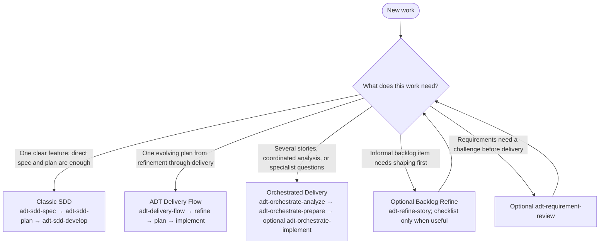

# Choosing the flow

Choose a feature-delivery path by the work shape and coordination needed. The paths are independent recommendations; none is a prerequisite for another. Backlog refinement and requirement review are optional helpers.

## Decision tree

The `adt-delivery-flow` is separate from Classic SDD and Orchestrated Delivery. Do not import their artifact trees or execution gates into it. A brownfield or specialist question alone does not require a separate analysis folder; use Orchestrated Delivery when coordination across stories or concrete specialist analysis helps.

## Flow table

| Flow | When to use | Entry point | Plan shape and approval |
|------|-------------|-------------|-------------------------|
| Classic SDD | One feature with a clear path | `adt-sdd-spec` → `adt-sdd-plan` → `adt-sdd-develop` | PRD and PLAN under the story folder; one complete PLAN approval before implementation. [Classic SDD](../sessions/02-classic-sdd.md) |
| ADT Delivery Flow | End-to-end refinement, planning, implementation and review around one evolving feature plan | `adt-delivery-flow` (or a stage skill directly) | One `features/NNN-slug/PLAN.md`; refinement and planning happen in that file, followed by one explicit plan approval. [ADT Delivery](../sessions/10-adt-delivery.md) |
| Orchestrated Delivery | Multi-story work or coordinated investigation / implementation | `adt-orchestrate-analyze` → `adt-orchestrate-prepare` → optional `adt-orchestrate-implement` | FEATURE/STORY context as relevant, PRD and PLAN per selected story; one approval for the explicitly listed complete PLAN set. [Orchestrated Delivery](../sessions/01-orchestrated-delivery.md) |
| Backlog Refine | An informal bug, story, or technical item needs shaping before delivery | `adt-refine-story` | A refined STORY when useful; the task checklist is optional and no delivery path requires Backlog Refine first. [Backlog shape](../sessions/03-backlog-shape.md) |
| Requirement review | A requirement needs a functional or repository-grounded challenge | `adt-requirement-review --feature` or `--tech` | Review report and question history under `REFINE/` after explicit approval; then choose a delivery path. [Backlog shape](../sessions/03-backlog-shape.md) |

For a small isolated code change, `adt-developer` or a stack-specific developer skill is also available; use a delivery flow when its planning and handoff are needed.

## Decisions and artifacts

- Only an unanswered material decision that affects behavior, acceptance, scope, required access, or implementation blocks the affected work. Minor questions remain visible; unrelated work may continue.
- Drafting and saving requirements/plans is preparation. Classic SDD, Orchestrated Delivery O2, and ADT Delivery each have their own single plan-approval boundary before implementation; the artifact set differs by flow.
- Memory Bank, `CONTINUITY.md`, `CHANGE.md`, `TASKS.md`, and separate `ANALYSIS/`, `ARCH/`, or `SEC/` notes are not universal prerequisites. Use existing context when it is relevant; create a separate note only when it provides useful durable evidence or its owning skill requires it.
- The canonical requirements and approved plan for the selected path own acceptance and implementation progress. Generic document validators are optional diagnostics unless a specific skill explicitly requires one.

## Canonical paths

- Classic SDD PRDs and PLANs live under `features/NNN-slug/USnn/`; the default story is `US01` when none is specified.
- Orchestrated artifacts use the same `features/NNN-slug/` tree. Story folders and separate analysis notes are created when justified, not merely because work is brownfield or a specialist role was considered.
- ADT Delivery uses one evolving `features/NNN-slug/PLAN.md` for refinement, planning, and progress.
- `docs/backlog/` is a convenience location for backlog shaping and review; it is not a canonical PRD or PLAN destination.

## Implementation cadence

Classic `adt-sdd-develop` and Orchestrated O3 follow the cadence selected for the approved PLAN: `step_by_step` stops after one completed step; `continuous` advances through eligible steps until completion or a real blocker. O3 remains serial, one PLAN step per child. ADT Delivery follows its own cadence and lifecycle. Validation follows the approved plan and the scope's actual risks; reuse current evidence and rerun only checks invalidated by a change. See [PIPELINE.md](../../core/skills/_shared/sdd-artifacts/PIPELINE.md) for Classic/O1/O2/O3 contracts and the ADT guide for its separate lifecycle.
